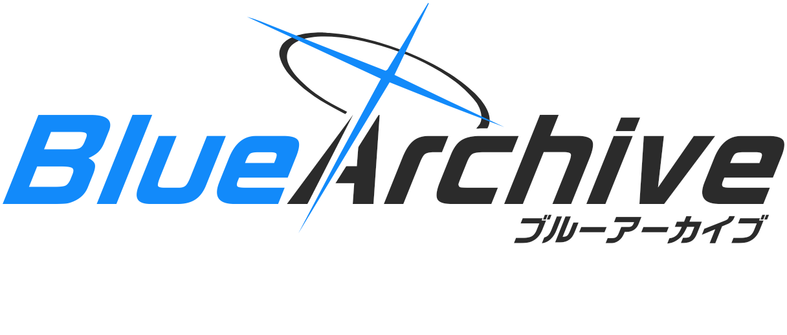
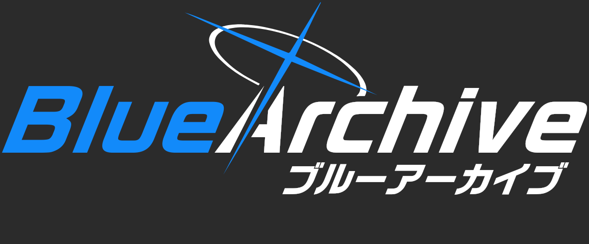
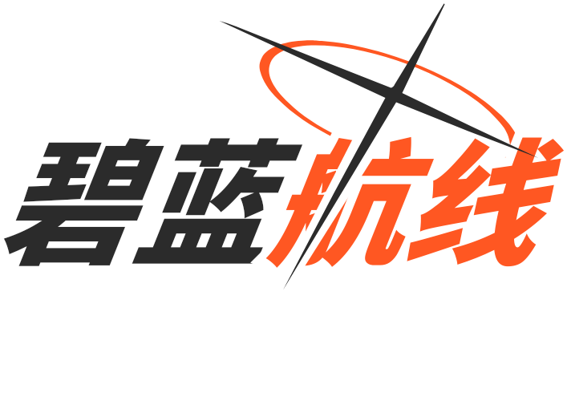
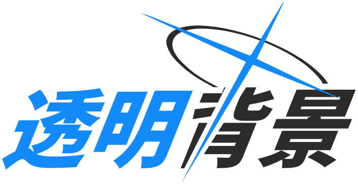
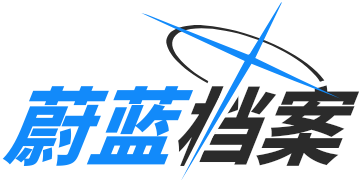
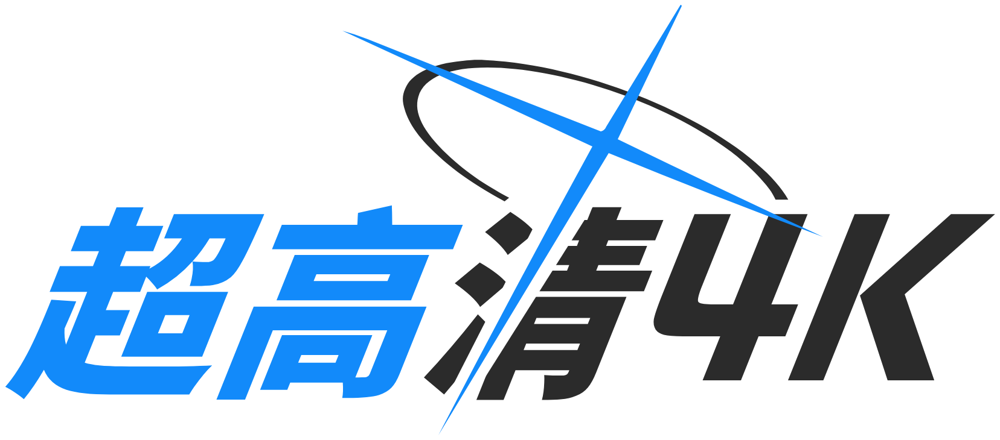

# Blue Archive Logo Generator (ブルーアーカイブ風ロゴジェネレーター)

<div align="center">



[English](README.md) | [简体中文](README.zh-CN.md) | [繁體中文](README.zh-TW.md) | 日本語 | [한국어](README.ko.md)

<br/>

**Bun** + **Elysia** + **Google Skia ネイティブ描画エンジン** で構築された、高パフォーマンス・ピクセル精度のブルーアーカイブ風ロゴ生成サービス。

[](https://bun.sh)
[](https://elysiajs.com)
[](https://github.com/Brooooooklyn/canvas)
[](https://vuejs.org)
[](https://github.com/sf-yuzifu/ba-logo-api/actions/workflows/ci.yml)
[](LICENSE)

[WebUI コンソール](#-kivotos-hud-コンソール) • [サンプルギャラリー](#-サンプルギャラリー) • [主な特徴](#-主な特徴) • [技術スタック](#-技術スタック) • [クイックスタート](#-クイックスタート) • [API 仕様](#-api-仕様) • [フォント参考](#-フォント仕様参考) • [謝辞](#-謝辞)

</div>

---

## 📸 サンプルギャラリー

| 公式英日サブタイトル風 (2x) | ダークモード (2x) |
| :---: | :---: |
|  |  |
| **カスタムアクセント＆配色反転 (2x)** | **透過背景くり抜き (明暗自動切替, 2x)** |
|  | <picture><source media="(prefers-color-scheme: dark)" srcset="samples/05-transparent-dark-2x.png#gh-dark-mode-only"><source media="(prefers-color-scheme: light)" srcset="samples/05-transparent-2x.png#gh-light-mode-only"></picture> |
| **標準中国語 (1x、余白最適化)** | **4K 印刷級超高解像度 (4x)** |
|  |  |

---

## ✨ 主な特徴

- ⚡ **圧倒的な高速描画**：C++/Rust でビルドされた Google Skia 2D ネイティブグラフィックエンジンを搭載。1 画像の生成時間はわずか **8〜15ms**。従来のヘッドレスブラウザ方式と比べ **150倍以上** 高速化。
- 🪶 **超低メモリ消費**：常駐 RSS は約 **30〜50 MB**、JS ヒープは **20 MB** 以下。サンドボックスオーバーヘッドがなく、最小構成（1コア/1GB）の VPS でも安定して動作可能。
- 🎨 **ピクセル精度のベクター切り抜き**：ヘイロー（Halo）と十字架（Cross）に高精度な SVG `Path2D` ベクター計算を採用。`scale=0.1〜8x` の任意の解像度変更に対応し、4K 出力でもぼやけません。
- 🌐 **包括的な CJK フォント対応**：欧文英数字、ひらがな・カタカナ、簡体字・繁体字中国語、韓国語ハングルを網羅した統合フォント（**30,000字以上**）を内蔵。
- 📦 **多彩な出力フォーマット**：`png`、`webp`、`jpeg` のほか、フォント不要で Illustrator や Figma に直接配置可能なアウトライン化ベクター `svg`、および JSON `base64` に対応。
- 🎛️ **Kivotos HUD コンソール**：ブルーアーカイブのゲーム画面をリスペクトしたリアルタイムプレビュー搭載の WebUI。レスポンシブな吸着配置やワンクリック共有に対応。
- 🔄 **高い後方互換性**：標準の RESTful 形式に加え、旧仕様の `/balogo` エンドポイントからのアクセスも HTTP 308 で自動転送されます。

---

## 🧰 技術スタック

| レイヤー | 技術 | 概要 |
| :--- | :--- | :--- |
| **ランタイム** | [Bun](https://bun.sh) (v1.3+) | 超高速 JavaScript/TypeScript ランタイム、高速コールドスタートと内蔵 HTTP エンジン |
| **Web フレームワーク** | [ElysiaJS](https://elysiajs.com) (v1.4+) | 高スループット・エンドツーエンド型安全な API フレームワーク（OpenAPI/Swagger 内蔵） |
| **描画エンジン** | [@napi-rs/canvas](https://github.com/Brooooooklyn/canvas) | Rust バインディングによる Google Skia 2D ネイティブグラフィックライブラリ |
| **WebUI フロントエンド** | [Vue 3](https://vuejs.org) + [Vite](https://vitejs.dev) | キヴォトス HUD スタイルのタクティカルコンソール（多言語・モバイル最適化） |
| **コード品質管理** | [Biome](https://biomejs.dev) + [TypeScript](https://www.typescriptlang.org) | 厳格な型検査、高速リント/フォーマット、自動化ユニットテスト |

---

## 🚀 クイックスタート

### ローカル環境での実行

事前に [Bun](https://bun.sh) (v1.3.14+) をインストールしてください。

```bash
# 1. リポジトリのクローン
git clone https://github.com/sf-yuzifu/ba-logo-api.git
cd ba-logo-api

# 2. 依存関係のインストール
bun install --frozen-lockfile

# 3. 開発サーバーの起動
bun dev
```

起動後、ブラウザでアクセスできます：
- **WebUI コンソール**：`http://localhost:3000/`
- **Swagger API ドキュメント**：`http://localhost:3000/swagger`
- **API 直接リクエスト**：`http://localhost:3000/api/logo?left=Blue&right=Archive`

### Docker による実行

```bash
# Docker Compose で起動
docker compose up -d

# または直接ビルドして起動
docker build -t ba-logo-api .
docker run -d -p 3000:3000 ba-logo-api
```

---

## 📡 API 仕様

RESTful エンドポイント：`GET /api/logo` *(旧 `GET /balogo` からも自動で HTTP 308 転送)*。

### 主なクエリパラメータ

| パラメータ | 短縮名 | 型 | デフォルト値 | 説明 |
| :--- | :--- | :--- | :--- | :--- |
| `left` | `l` | string | `"蔚蓝"` | 左側のテキスト（メインアクセント色） |
| `right` | `r` | string | `"档案"` | 右側のテキスト（サブ文字色） |
| `subtitle` | `sub` | string | `""` | 任意のサブタイトル（右下に斜体で整列配置） |
| `accentColor` | `accent` | string | `"#128AFA"` | メインアクセントカラー（16進数 Hex） |
| `textColor` | `color`, `tc` | string | `"#2B2B2B"` | 文字色（ダークモード時は白） |
| `darkMode` | `dark` | boolean | `false` | ダークモードの有効化 |
| `swapColors` | `swap` | boolean | `false` | 左右テキスト配色の反転 |
| `transparent`| `tp` | boolean | `false` | 背景の透過（図形のくり抜き処理が有効になります） |
| `scale` | `s` | number | `1` | 解像度スケール倍率（`0.1`〜`8.0`） |
| `format` | - | string | `"png"` | 出力形式：`png`, `webp`, `jpeg`, `svg`, `base64` |
| `center` | `vcenter`| boolean | *自動* | 縦方向の中央配置（サブタイトル有無に応じて自動最適化） |

*全パラメータの詳細仕様やオンライン検証は `/swagger` ページをご利用ください。*

### Markdown での埋め込み例

```markdown

```

---

## 🎛️ Kivotos HUD コンソール

`http://localhost:3000/` にアクセスすることで、専用のタクティカル HUD コンソールをご利用いただけます：
- **リアルタイム調整**：カラーパレット、オフセット微調整、文字間隔を視覚的にプレビュー；
- **多言語対応**：日本語、英語、簡体字中国語、繁体字中国語、韓国語の 5 言語に対応；
- **モバイル最適化**：スマホ・タブレット画面でプレビューを上部に固定し、操作バーを常駐；
- **ワンクリック共有**：API URL、Markdown 構文のコピーや高解像度画像のダウンロードに対応。

---

## 🔤 フォント仕様・参考

本プロジェクトの内蔵統合フォント（`assets/fonts/ba.ttf`、約 9.15 MB、計 **30,000字以上**）は、ゲーム公式のタイポグラフィと視覚的プロポーションを忠実に再現するよう統合されています：

| 言語・文字体系 | 主要フォント選定 | 出典・参考情報 |
| :--- | :--- | :--- |
| **英数ラテン文字・日文かな** | [RoG2サンセリフStd B](https://www.morisawa.co.jp/fonts/specimen/1646) | モリサワ（Morisawa）製の公式原版サンセリフ書体。英数字・ひらがな・カタカナを担当 |
| **簡体字・繁体字中国語** | [未来螢黒 (Glow Sans)](https://github.com/welai/glow-sans) (Heavy) | 源ノ角ゴシック派生のオープンソース広幅ゴシック体。RoGSans の線幅と高精度に調和 |
| **韓国語ハングル (Hangul)** | [Gyeonggi Cheonnyeon Title (경기천년제목)](https://www.gg.go.kr/contents/contents.do?ciIdx=679) (Bold) | 韓国版公式タイトルに採用されている重厚で力強い同系統の地域ゴシック体 |
| **フォント統合パイプライン** | [Warcraft-Font-Merger](https://github.com/nowar-fonts/Warcraft-Font-Merger) | ベースライン補正とグリフ統合を実行し、単一 TTF として Skia メモリに常駐 |

---

## 📜 謝辞

本プロジェクトは [MIT License](LICENSE) のもとで公開されています。

本ツールの基礎を築いてくださった先駆的オープンソース開発者とコントリビューターの皆様に深く感謝いたします：
- **[@nulla2011](https://github.com/nulla2011)**：先駆的な Canvas 実装 [bluearchive-logo](https://github.com/nulla2011/bluearchive-logo)（[オリジナルサイト](https://lab.nulla.top/ba-logo/)）を開発し、幾何配置の基礎を確立。
- **[@jozsefsallai](https://github.com/jozsefsallai)** (PR #6)：ヘイローと十字架の高精度ベクター SVG パス、およびダークモードのコンセプトを提供。
- **[@RedBeanN](https://github.com/RedBeanN)** ([BALogo](https://github.com/RedBeanN/BALogo))：多言語を網羅した高品質な統合フォント資産 `ba.ttf` を提供。
- **[@WUGqnwvMQPzl](https://github.com/WUGqnwvMQPzl)** および **[@waterv](https://github.com/waterv)**：高解像度スケーリングの構想や動的余白クリッピングの修正に貢献。

---

<div align="center">

*免責事項：『ブルーアーカイブ』に関する商標、ロゴおよび知的財産権は NEXON Games Co., Ltd. および 株式会社Yostar に帰属します。本プロジェクトは技術的探究およびファン創作を目的とした非公式の同人開発物です。*

</div>
