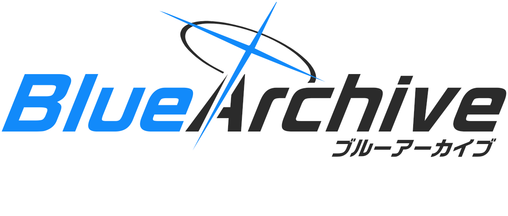
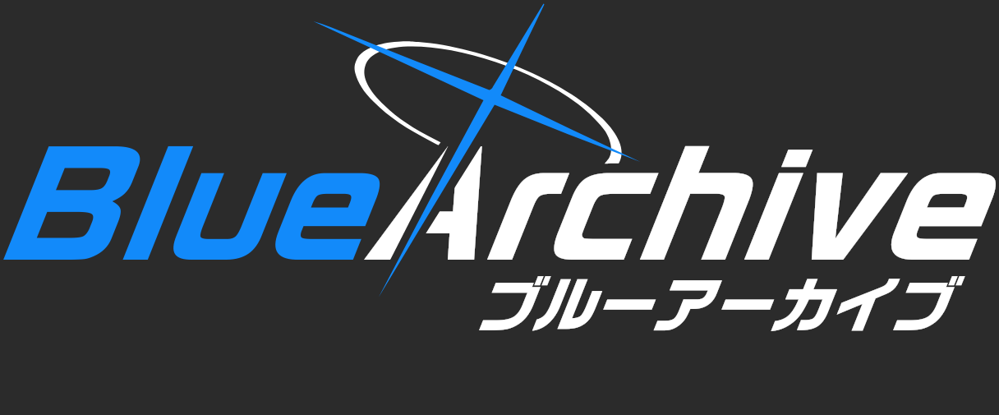
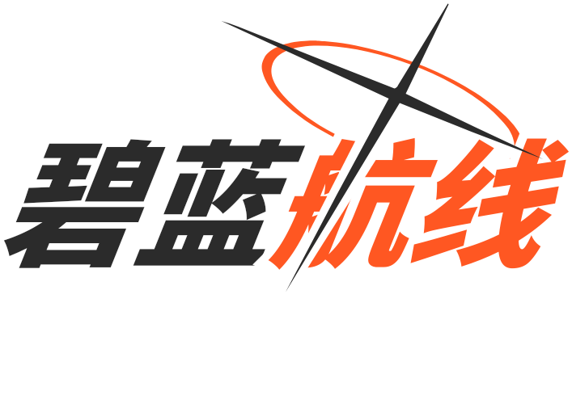
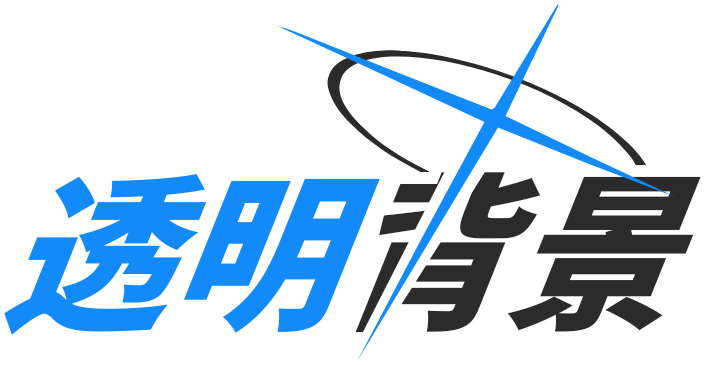
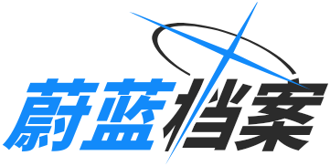
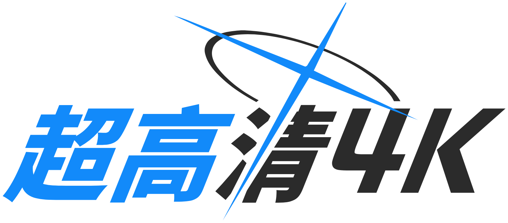
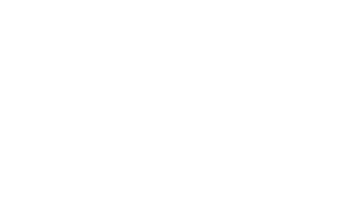

# Blue Archive Logo Generator (블루 아카이브 스타일 로고 생성기)

<div align="center">



[English](README.md) | [简体中文](README.zh-CN.md) | [繁體中文](README.zh-TW.md) | [日本語](README.ja.md) | 한국어

<br/>

**Bun** + **Elysia** + **Google Skia 네이티브 그래픽 엔진** 기반의 초고속·픽셀 완벽 블루 아카이브 스타일 로고 생성 서비스.

[](https://bun.sh)
[](https://elysiajs.com)
[](https://github.com/Brooooooklyn/canvas)
[](https://vuejs.org)
[](https://github.com/sf-yuzifu/ba-logo-api/actions/workflows/ci.yml)
[](LICENSE)

[WebUI 대시보드](#-kivotos-hud-대시보드) • [샘플 갤러리](#-샘플-갤러리) • [주요 기능](#-주요-기능) • [기술 스택](#-기술-스택) • [빠른 시작](#-빠른-시작) • [API 안내](#-api-안내) • [폰트 에셋](#-폰트-에셋-참고) • [감사의 말](#-감사의-말)

</div>

---

## 📸 샘플 갤러리

| 공식 영문+일본어 부제 스타일 (2x) | 다크 모드 (2x) |
| :---: | :---: |
|  |  |
| **커스텀 포인트 컬러 및 반전 (2x)** | **투명 배경 컷아웃 (다크/라이트 자동 전환, 2x)** |
|  | <picture><source media="(prefers-color-scheme: dark)" srcset="samples/05-transparent-dark-2x.png#gh-dark-mode-only"><source media="(prefers-color-scheme: light)" srcset="samples/05-transparent-2x.png#gh-light-mode-only"></picture> |
| **표준 한자 (1x, 여백 최적화)** | **4K 인쇄급 초고해상도 (4x)** |
|  |  |
| **등장 애니메이션 (GIF, 24fps)** | **공식 영문+일문 부제 애니메이션 (APNG 고화질)** |
|  |  |

---

## ✨ 주요 기능

- ⚡ **압도적인 렌더링 성능**：C++/Rust로 사전 컴파일된 Google Skia 2D 네이티브 엔진을 적용하여, 이미지 1장당 생성 시간이 **8~15ms** 수준에 불과합니다. 기존 헤드리스 브라우저 대비 **150배 이상** 빠릅니다.
- 🎬 **로고 애니메이션 (GIF & APNG)**: 양쪽 글자가 수평으로 가까워지며 왼쪽은 위에서 아래로, 오른쪽은 아래에서 위로 색이 채워집니다. 십자가는 중심에서 바깥으로 뻗어나가고, 헤일로와 부제목은 왼쪽에서 오른쪽으로 나타납니다. GIF와 무손실 APNG로 내보낼 수 있습니다.
- 🪶 **초경량 메모리 사용량**：상주 RSS는 약 **30~50 MB**, JS 힙 메모리는 **20 MB** 이하를 유지합니다. 샌드박스 오버헤드가 없어 1코어 1GB 저사양 인스턴스에서도 원활하게 구동됩니다.
- 🎨 **픽셀 완벽 벡터 그래픽**：헤일로(Halo) 및 십자가(Cross)에 수학적 정밀도를 가진 SVG `Path2D` 벡터 경로를 사용하여, `scale=0.1~8x` 확대 시에도 4K 해상도까지 선명합니다.
- 🌐 **완벽한 CJK 다국어 폰트**：라틴 문자, 일본어 가나, 한국어 한글, 중국어 간체/번체를 아우르는 통합 글꼴 에셋(**30,000자 이상**)이 내장되어 있습니다.
- 📦 **다양한 출력 포맷**：`png`, `webp`, `jpeg`, 외장 폰트 불필요 아웃라인 벡터 `svg` (Figma / Illustrator 바로 호환), JSON `base64`, 그리고 `gif` / `apng` 움직이는 이미지 지원.
- 🎛️ **Kivotos HUD 웹 콘솔**：블루 아카이브의 전술 인터페이스 감성을 살린 웹 UI를 내장하여, 실시간 미리보기, 반응형 스티키 뷰포트, 원클릭 공유 기능을 지원합니다.
- 🔄 **하위 호환성 유지**：표준 RESTful 엔드포인트를 제공하며, 기존 `/balogo` 요청도 HTTP 308 영구 리다이렉션을 통해 자연스럽게 호환됩니다.

---

## 🧰 기술 스택

| 레이어 | 기술 | 설명 |
| :--- | :--- | :--- |
| **런타임** | [Bun](https://bun.sh) (v1.3+) | 네이티브 초고속 JavaScript/TypeScript 런타임 및 고성능 HTTP 엔진 |
| **웹 프레임워크** | [ElysiaJS](https://elysiajs.com) (v1.4+) | 엔드투엔드 타입 안전성을 보장하는 고처리량 프레임워크 (OpenAPI/Swagger 내장) |
| **렌더링 엔진** | [@napi-rs/canvas](https://github.com/Brooooooklyn/canvas) | Rust 바인딩 기반의 Google Skia 2D 네이티브 그래픽 라이브러리 |
| **웹 UI 프론트엔드** | [Vue 3](https://vuejs.org) + [Vite](https://vitejs.dev) | 키보토스 HUD 스타일 반응형 대시보드 (다국어 및 모바일 최적화) |
| **코드 품질 관리** | [Biome](https://biomejs.dev) + [TypeScript](https://www.typescriptlang.org) | 엄격한 타입 체크, 고속 린트 및 포맷팅, 자동화 단위 테스트 |

---

## 🚀 빠른 시작

### 로컬 환경 실행

[Bun](https://bun.sh) (v1.3.14+) 환경이 필요합니다.

```bash
# 1. 저장소 복제
git clone https://github.com/sf-yuzifu/ba-logo-api.git
cd ba-logo-api

# 2. 의존성 설치
bun install --frozen-lockfile

# 3. 개발 서버 실행
bun dev
```

서버 실행 후 브라우저에서 바로 접속할 수 있습니다:
- **웹 UI 대시보드**: `http://localhost:3000/`
- **Swagger API 문서**: `http://localhost:3000/swagger`
- **직접 이미지 요청**: `http://localhost:3000/api/logo?left=블루&right=아카이브`

### Docker 환경 실행

```bash
# Docker Compose로 실행
docker compose up -d

# 또는 수동 빌드 후 실행
docker build -t ba-logo-api .
docker run -d -p 3000:3000 ba-logo-api
```

---

## 📡 API 안내

RESTful 엔드포인트: `GET /api/logo` *(이전 `GET /balogo` 요청도 HTTP 308로 자동 전환됩니다)*.

### 주요 쿼리 파라미터

| 파라미터 | 별칭 | 타입 | 기본값 | 설명 |
| :--- | :--- | :--- | :--- | :--- |
| `left` | `l` | string | `"蔚蓝"` | 좌측 텍스트 (메인 포인트 컬러) |
| `right` | `r` | string | `"档案"` | 우측 텍스트 (보조 글자 색상) |
| `subtitle` | `sub` | string | `""` | 우측 하단 기울임 정렬 부제목 |
| `accentColor` | `accent` | string | `"#128AFA"` | 메인 포인트 색상 (Hex 코드) |
| `textColor` | `color`, `tc` | string | `"#2B2B2B"` | 기본 글자 색상 (다크 모드 시 흰색) |
| `darkMode` | `dark` | boolean | `false` | 다크 모드 활성화 |
| `swapColors` | `swap` | boolean | `false` | 좌우 텍스트 색상 테마 맞교환 |
| `transparent`| `tp` | boolean | `false` | 배경 투명화 (도형 컷아웃 마스킹 적용) |
| `scale` | `s` | number | `1` | 해상도 배율 (`0.1` ~ `8.0`) |
| `format` | - | string | `"png"` | 출력 포맷: `png`, `webp`, `jpeg`, `svg`, `base64` |
| `center` | `vcenter`| boolean | *자동* | 수직 중앙 정렬 (부제목 유무에 따라 자동 여백 균형 조정) |

*자세한 파라미터 규격과 대화형 테스트는 `/swagger` 페이지를 참고하십시오.*

### 마크다운 삽입 예시

```markdown

```

---

## 🎛️ Kivotos HUD 대시보드

`http://localhost:3000/` 접속 시 키보토스 테마의 전술 콘솔을 이용할 수 있습니다:
- **실시간 비주얼 튜닝**: 색상 팔레트, 픽셀 단위 오프셋, 글자 간격 디바운스 조정;
- **5개 국어 현지화**: 한국어, 일본어, 영어, 중국어 간체, 번체 인터페이스 지원;
- **모바일 화면 최적화**: 모바일 및 태블릿 환경에 맞춘 상단 스티키 뷰포트와 하단 플로팅 액션 바;
- **손쉬운 내보내기**: 완성된 API 링크 생성, 마크다운 코드 복사, 초고해상도 이미지 다운로드 지원.

---

## 🔤 폰트 에셋 참고

본 프로젝트에 내장된 고품질 통합 폰트(`assets/fonts/ba.ttf`, 약 9.15 MB, 총 **30,000자 이상**)는 게임 공식 타이포그래피의 시각적 비례를 완벽하게 재현하도록 사전 병합되었습니다:

| 언어 및 문자 체계 | 주 폰트 구성 | 출처 및 참고 안내 |
| :--- | :--- | :--- |
| **라틴 문자 및 일본어 가나** | [RoG2 Sans Serif Std B](https://www.morisawa.co.jp/fonts/specimen/1646) | 일본 모리사와(Morisawa)에서 출시한 오리지널 공식 산세리프 서체. 영숫자 및 일본어 담당 |
| **중국어 간체 및 번체** | [미래형흑 (Glow Sans)](https://github.com/welai/glow-sans) (Heavy) | 본고딕(Source Han Sans) 기반 오픈소스 와이드 산세리프 서체. RoGSans 획 굵기와 정밀 일치 |
| **한국어 한글 (Hangul)** | [경기천년제목](https://www.gg.go.kr/contents/contents.do?ciIdx=679) (Bold) | 한국어 공식 타이틀에 사용된 묵직하고 강렬한 인상의 지역 공공 산세리프 서체 |
| **폰트 병합 빌드 파이프라인** | [Warcraft-Font-Merger](https://github.com/nowar-fonts/Warcraft-Font-Merger) | 베이스라인 미세 조정 및 글리프 병합을 거쳐 단일 TTF로 Skia 메모리에 상주 |

---

## 📜 감사의 말

본 프로젝트는 [MIT License](LICENSE)에 따라 오픈 소스로 배포됩니다.

오픈 소스 생태계를 빛내주신 선행 프로젝트 개발자분들께 감사드립니다:
- **[@nulla2011](https://github.com/nulla2011)**: 표준적인 Canvas 구현체인 [bluearchive-logo](https://github.com/nulla2011/bluearchive-logo)([원작 웹 페이지](https://lab.nulla.top/ba-logo/))를 제작하여 기하학적 배치 알고리즘의 기초를 확립.
- **[@jozsefsallai](https://github.com/jozsefsallai)** (PR #6): 헤일로 및 십자가의 고정밀 SVG 벡터 패스 및 다크 모드 개념 제공.
- **[@RedBeanN](https://github.com/RedBeanN)** ([BALogo](https://github.com/RedBeanN/BALogo)): 방대한 다국어 글꼴을 깔끔하게 병합한 `ba.ttf` 에셋 제공.
- **[@WUGqnwvMQPzl](https://github.com/WUGqnwvMQPzl)** 및 **[@waterv](https://github.com/waterv)**: 고해상도 캔버스 스케일링 아이디어와 동적 바운딩 박스 오차 수정에 기여.

---

<div align="center">

*면책 조항: 블루 아카이브(Blue Archive)와 관련된 상표, 로고 및 지식재산권은 NEXON Games Co., Ltd. 및 Yostar, Inc.에 귀속됩니다. 본 프로젝트는 순수 기술 연구 및 팬 창작 목적의 비공식 2차 창작물입니다.*

</div>
