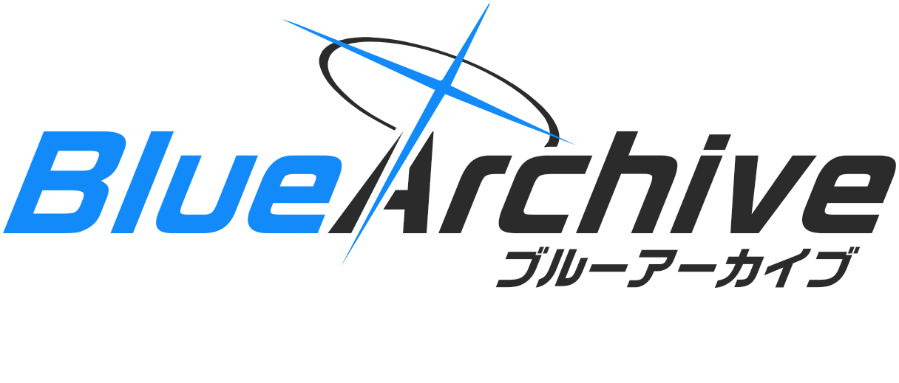
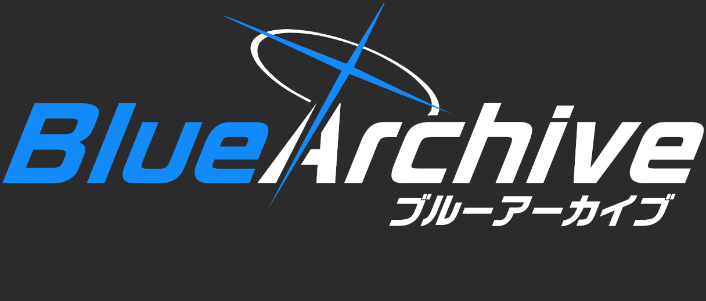
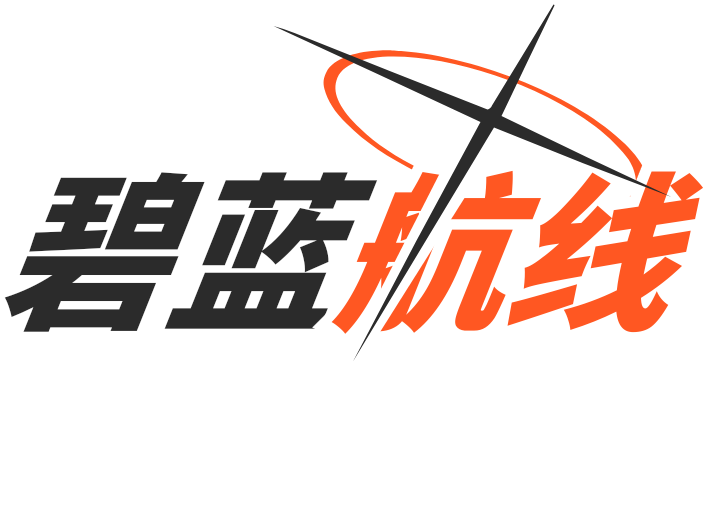
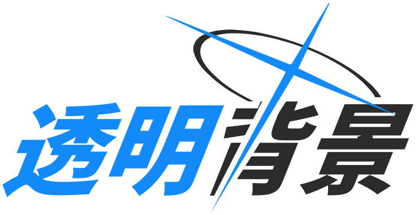
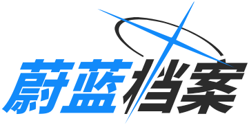
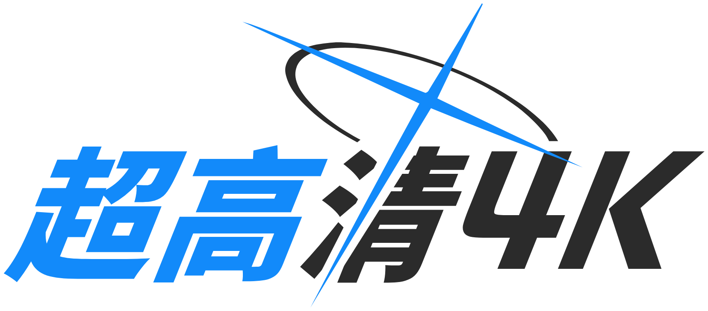

# Blue Archive Logo Generator

<div align="center">



English | [简体中文](README.zh-CN.md) | [繁體中文](README.zh-TW.md) | [日本語](README.ja.md) | [한국어](README.ko.md)

<br/>

A high-performance, pixel-perfect Blue Archive style logo generation service powered by **Bun**, **Elysia**, and **Google Skia**.

[](https://bun.sh)
[](https://elysiajs.com)
[](https://github.com/Brooooooklyn/canvas)
[](https://vuejs.org)
[](https://github.com/sf-yuzifu/ba-logo-api/actions/workflows/ci.yml)
[](LICENSE)

[Live WebUI](#-kivotos-hud-webui) • [Showcase](#-showcase) • [Features](#-features) • [Tech Stack](#-tech-stack) • [Quick Start](#-quick-start) • [API Reference](#-api-reference) • [Typography](#-typography--font-assets) • [Credits](#-acknowledgements)

</div>

---

## 📸 Showcase

| Official Style (EN + JA Subtitle, 2x) | Dark Mode (2x) |
| :---: | :---: |
|  |  |
| **Custom Color Swap (2x)** | **Transparent Cutout (Auto Theme, 2x)** |
|  | <picture><source media="(prefers-color-scheme: dark)" srcset="samples/05-transparent-dark-2x.png#gh-dark-mode-only"><source media="(prefers-color-scheme: light)" srcset="samples/05-transparent-2x.png#gh-light-mode-only"></picture> |
| **Standard Chinese (1x, Balanced Margins)** | **Ultra HD Print-Ready (4x)** |
|  |  |
| **Animated Entrance (GIF, 24fps)** | **Official Anime Entrance (APNG HD)** |
|  |  |

---

## ✨ Features

- ⚡ **Blazing Fast**: Native C++/Rust Google Skia graphics engine. Sub-15ms cold/warm generation latency — over **150x faster** than legacy headless browser rendering.
- 🎬 **Animated GIF & APNG Generation**: Text slides inward horizontally, with color filling top-to-bottom on the left and bottom-to-top on the right. The cross extends from its center; the halo and subtitle reveal from left to right. Export as GIF or lossless APNG.
- 🪶 **Ultra Lightweight**: Resident memory stays around **30–50 MB RSS** with JS heap under **20 MB**. Runs smoothly on entry-level 1-vCPU/1-GB servers without sandbox overhead.
- 🎨 **Pixel-Perfect Vector Graphics**: Mathematical SVG `Path2D` vector outlines for the iconic Halo and Cross. Supports dynamic scaling (`scale=0.1~8x`) up to 4K+ print resolution without pixelation.
- 🌐 **Comprehensive CJK Typography**: Merged high-quality TrueType font asset containing **30,000+ glyphs**, supporting Latin, Japanese Kana, Simplified Chinese, Traditional Chinese, and Korean Hangul.
- 📦 **Multi-Format Exports**: Native raster exports for `png`, `webp`, and `jpeg`, plus pure vector `svg` (fully outlined paths for direct import into Figma / Illustrator), JSON `base64`, `gif`, and `apng`.
- 🎛️ **Kivotos HUD WebUI**: Built-in responsive frontend inspired by Blue Archive's tactical HUD, featuring real-time preview, debounced rendering, sticky mobile layout, and one-click URL sharing.
- 🔄 **Drop-in Compatibility**: Full backward compatibility with legacy `/balogo` endpoints via automatic HTTP 308 permanent redirect.

---

## 🧰 Tech Stack

| Layer | Technology | Description |
| :--- | :--- | :--- |
| **Runtime** | [Bun](https://bun.sh) (v1.3+) | High-performance JavaScript/TypeScript runtime with instant startup |
| **Web Framework** | [ElysiaJS](https://elysiajs.com) (v1.4+) | Fast, ergonomic, type-safe API framework with built-in OpenAPI/Swagger |
| **Rendering Engine** | [@napi-rs/canvas](https://github.com/Brooooooklyn/canvas) | Native Rust bindings for Google Skia 2D graphics |
| **Frontend WebUI** | [Vue 3](https://vuejs.org) + [Vite](https://vitejs.dev) | Interactive Kivotos HUD console with i18n and responsive layout |
| **Quality & Tooling** | [Biome](https://biomejs.dev) + [TypeScript](https://www.typescriptlang.org) | Strict type checking, linting, formatting, and unit testing |

---

## 🚀 Quick Start

### Prerequisites

Ensure you have [Bun](https://bun.sh) (v1.3.14+) installed.

```bash
# 1. Clone repository
git clone https://github.com/sf-yuzifu/ba-logo-api.git
cd ba-logo-api

# 2. Install dependencies
bun install --frozen-lockfile

# 3. Start development server
bun dev
```

Open your browser:
- **WebUI Console**: `http://localhost:3000/`
- **Swagger Documentation**: `http://localhost:3000/swagger`
- **Direct API Call**: `http://localhost:3000/api/logo?left=Blue&right=Archive`

### Run with Docker

```bash
# Using Docker Compose
docker compose up -d

# Or build manually
docker build -t ba-logo-api .
docker run -d -p 3000:3000 ba-logo-api
```

---

## 📡 API Reference

Modern RESTful endpoint: `GET /api/logo` *(Legacy `GET /balogo` automatically redirects with HTTP 308)*.

### Key Query Parameters

| Parameter | Alias | Type | Default | Description |
| :--- | :--- | :--- | :--- | :--- |
| `left` | `l` | string | `"蔚蓝"` | Left text (primary accent color) |
| `right` | `r` | string | `"档案"` | Right text (secondary text color) |
| `subtitle` | `sub` | string | `""` | Optional italicized subtitle aligned at the bottom right |
| `subtitleFontSize` | `subSize` | number | `30` | Base subtitle font size (`12`–`96`, scales with `scale`) |
| `accentColor` | `accent` | string | `"#128AFA"` | Primary brand accent color (Hex) |
| `textColor` | `color`, `tc` | string | `"#2B2B2B"` | Main text color (white in dark mode) |
| `darkMode` | `dark` | boolean | `false` | Enable dark theme with inverted colors |
| `swapColors` | `swap` | boolean | `false` | Swap left and right text color themes |
| `transparent`| `tp` | boolean | `false` | Transparent background with cutout motifs |
| `scale` | `s` | number | `1` | Resolution scaling multiplier (`0.1` to `8.0`) |
| `format` | - | string | `"png"` | Output format: `png`, `webp`, `jpeg`, `svg`, `base64` |
| `center` | `vcenter`| boolean | *auto* | Vertically center content (defaults to `true` with subtitle, `false` without) |

*For complete parameter schemas and interactive testing, please visit the interactive `/swagger` page.*

### Quick Markdown Integration

```markdown

```

---

## 🎛️ Kivotos HUD WebUI

Accessing `http://localhost:3000/` launches the custom-crafted Kivotos Tactical Console:
- **Interactive Controls**: Real-time tuning for colors, offsets, margins, and typography.
- **Multilingual Support**: Built-in localization for English, Simplified Chinese, Traditional Chinese, Japanese, and Korean.
- **Mobile Responsive**: Sticky live viewport on mobile and tablets with floating action bars.
- **One-Click Sharing**: Copy direct API links, Markdown snippets, or download high-res images instantly.

---

## 🔤 Typography & Font Assets

The built-in multi-language font (`assets/fonts/ba.ttf`, ~9.15 MB, **30,000+ glyphs**) is pre-merged to deliver authentic in-game visual proportions across all supported scripts:

| Script / Region | Primary Font | Source & Reference |
| :--- | :--- | :--- |
| **Latin & Japanese Kana** | [RoG2 Sans Serif Std B](https://www.morisawa.co.jp/fonts/specimen/1646) | Official Morisawa bold sans-serif typeface used in Blue Archive |
| **Simplified & Traditional Chinese** | [Glow Sans (未来荧黑)](https://github.com/welai/glow-sans) (Heavy) | Open-source wide CJK sans-serif matching RoGSans stroke weight |
| **Korean Hangul** | [Gyeonggi Cheonnyeon Title](https://www.gg.go.kr/contents/contents.do?ciIdx=679) (Bold) | Official regional Korean title bold typeface used in the KR release |
| **Font Merging Pipeline** | [Warcraft-Font-Merger](https://github.com/nowar-fonts/Warcraft-Font-Merger) | Baseline adjustment and glyph merging into a single static TTF asset |

---

## 📜 Acknowledgements

This project is licensed under the [MIT License](LICENSE).

Special thanks to the following open-source contributors and upstream projects:
- **[@nulla2011](https://github.com/nulla2011)**: Created the seminal [bluearchive-logo](https://github.com/nulla2011/bluearchive-logo) ([Original Web Page](https://lab.nulla.top/ba-logo/)) and established the geometric layout foundation.
- **[@jozsefsallai](https://github.com/jozsefsallai)** (PR #6): Contributed vector SVG paths for the halo and cross, and originated the dark mode concept.
- **[@RedBeanN](https://github.com/RedBeanN)** ([BALogo](https://github.com/RedBeanN/BALogo)): Provided the comprehensive merged `ba.ttf` multi-language font assets.
- **[@WUGqnwvMQPzl](https://github.com/WUGqnwvMQPzl)** & **[@waterv](https://github.com/waterv)**: Contributed high-resolution canvas scaling ideas and dynamic bounds boundary edge fixes.

---

<div align="center">

*Disclaimer: Blue Archive assets, symbols, and related intellectual property are trademarks and copyrights of NEXON Games Co., Ltd. and Yostar, Inc. This project is an unofficial fan creation for technical demonstration and educational purposes only.*

</div>
