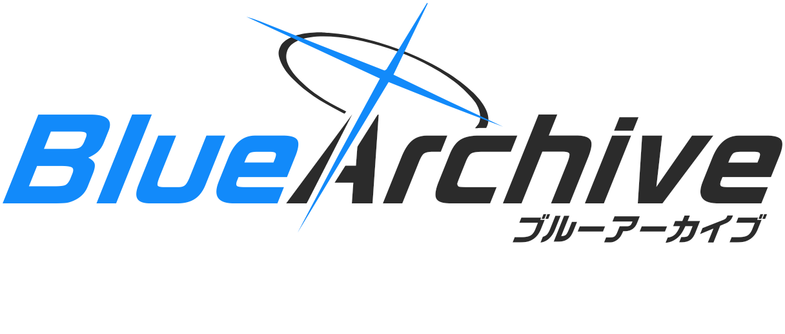
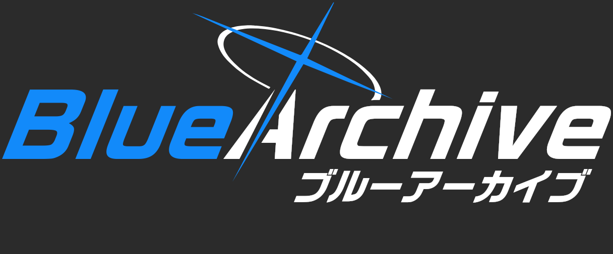
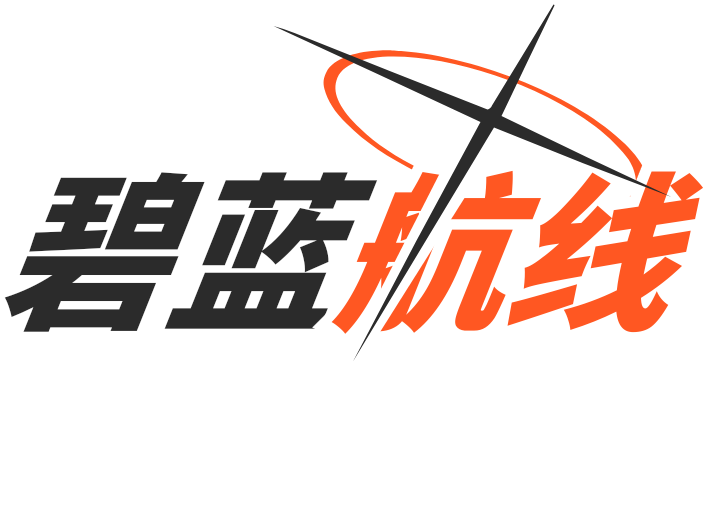
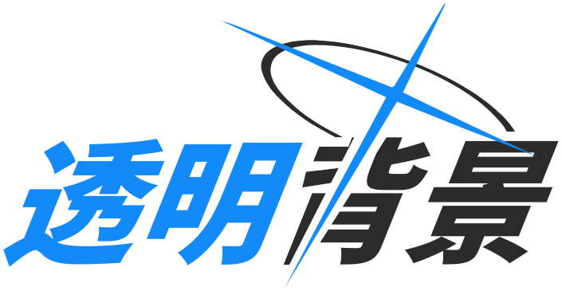
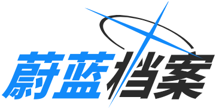
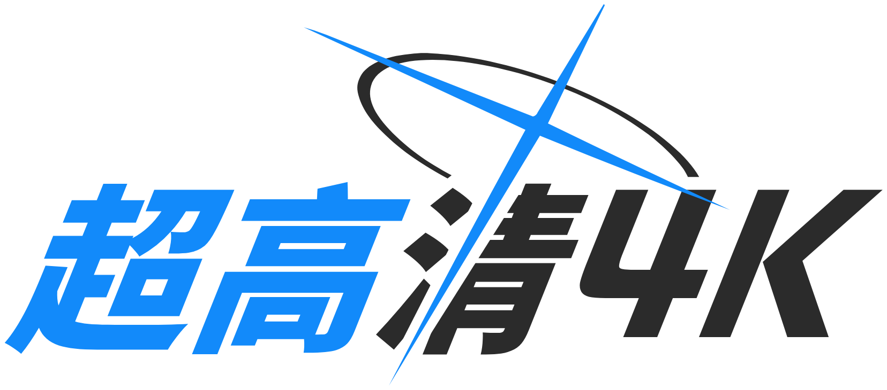

# Blue Archive Logo Generator (蔚蓝档案风格 Logo 生成器)

<div align="center">



[English](README.md) | 简体中文 | [繁體中文](README.zh-TW.md) | [日本語](README.ja.md) | [한국어](README.ko.md)

<br/>

基于 **Bun** + **Elysia** + **Google Skia 原生图形引擎** 构建的高性能、像素级还原蔚蓝档案风格 Logo 生成服务。

[](https://bun.sh)
[](https://elysiajs.com)
[](https://github.com/Brooooooklyn/canvas)
[](https://vuejs.org)
[](https://github.com/sf-yuzifu/ba-logo-api/actions/workflows/ci.yml)
[](LICENSE)

[在线 WebUI 控制台](#-kivotos-hud-控制台) • [样例展示](#-样例展示) • [核心特性](#-核心特性) • [技术栈](#-技术栈架构) • [快速开始](#-快速开始) • [API 速览](#-api-调用速览) • [字体参考](#-字体资产参考) • [致谢](#-鸣谢与致敬)

</div>

---

## 📸 样例展示

| 官方英日副标题风格 (2x) | 暗黑模式 (2x) |
| :---: | :---: |
|  |  |
| **自定义强调色与对调 (2x)** | **透明背景镂空裁切 (明暗自适应, 2x)** |
|  | <picture><source media="(prefers-color-scheme: dark)" srcset="samples/05-transparent-dark-2x.png#gh-dark-mode-only"><source media="(prefers-color-scheme: light)" srcset="samples/05-transparent-2x.png#gh-light-mode-only"></picture> |
| **标准中文 (1x，关闭居中对齐)** | **4K 印刷级超高清 (4x)** |
|  |  |

---

## ✨ 核心特性

- ⚡ **极致性能跃迁**：基于底层 C++/Rust 编译的 Google Skia 原生 2D 图形内核，单图生成延迟低至 **8~15ms**，较传统无头浏览器渲染方案提速超 **150 倍**。
- 🪶 **极低内存占用**：常驻内存仅 **30~50 MB RSS**，JS 堆内存维持在 **20 MB** 以内，无沙箱负担，1C1G 入门级服务器也能丝滑运行。
- 🎨 **像素级矢量精度**：光环（Halo）与十字架（Cross）采用高精度 SVG `Path2D` 矢量切除算法，支持 `scale=0.1~8x` 任意缩放，4K 印刷级大图依然清晰锐利。
- 🌐 **全量 CJK 字形库**：内置合并字库（超过 **30,000 个字形**），完整覆盖拉丁字母、日文假名、简体中文、繁体中文及韩文谚文。
- 📦 **现代多格式输出**：原生支持 `png`、`webp`、`jpeg`，以及免字体的纯矢量轮廓 `svg`（可直接导入 Figma / Illustrator）和 JSON `base64`。
- 🎛️ **Kivotos HUD 控制台**：专为同人创作定制的战术仪表盘前端，支持实时防抖预览、响应式双栏/移动端吸顶布局及一键分享链接。
- 🔄 **平滑向下兼容**：支持标准 RESTful 规范，原有 `/balogo` 端点自动发起 HTTP 308 永久重定向并完整透传参数。

---

## 🧰 技术栈架构

| 层级 | 技术选型 | 说明 |
| :--- | :--- | :--- |
| **运行环境** | [Bun](https://bun.sh) (v1.3+) | 极速 JavaScript/TypeScript 运行时，原生秒级冷启动与高效 HTTP 服务 |
| **Web 框架** | [ElysiaJS](https://elysiajs.com) (v1.4+) | 基于 TypeBox 的端到端类型安全高性能微框架，内置 Swagger / OpenAPI |
| **图形渲染内核** | [@napi-rs/canvas](https://github.com/Brooooooklyn/canvas) | 基于 Rust 绑定的 Google Skia 2D 原生绘图引擎 |
| **WebUI 前端** | [Vue 3](https://vuejs.org) + [Vite](https://vitejs.dev) | 蔚蓝档案 Kivotos HUD 战术风格交互界面，支持多语言与移动端自适应 |
| **代码工程化** | [Biome](https://biomejs.dev) + [TypeScript](https://www.typescriptlang.org) | 严格类型检查、秒级格式化、静态 Lint 与自动化测试套件 |

---

## 🚀 快速开始

### 本地运行

请确保已安装 [Bun](https://bun.sh)（v1.3.14+）：

```bash
# 1. 克隆代码仓库
git clone https://github.com/sf-yuzifu/ba-logo-api.git
cd ba-logo-api

# 2. 安装项目依赖
bun install --frozen-lockfile

# 3. 启动本地开发服务
bun dev
```

服务启动后即可访问：
- **WebUI 交互控制台**：`http://localhost:3000/`
- **Swagger 接口调试页**：`http://localhost:3000/swagger`
- **直接获取图片**：`http://localhost:3000/api/logo?left=蔚蓝&right=档案`

### 使用 Docker 部署

```bash
# 使用 Docker Compose 一键启动
docker compose up -d

# 或手动构建运行
docker build -t ba-logo-api .
docker run -d -p 3000:3000 ba-logo-api
```

---

## 📡 API 调用速览

现代 RESTful 接口路径：`GET /api/logo` *(旧接口 `GET /balogo` 自动 308 重定向)*。

### 核心查询参数

| 参数名 | 别名 | 类型 | 默认值 | 说明 |
| :--- | :--- | :--- | :--- | :--- |
| `left` | `l` | string | `"蔚蓝"` | 左侧文本（主强调色） |
| `right` | `r` | string | `"档案"` | 右侧文本（次要颜色） |
| `subtitle` | `sub` | string | `""` | 可选副标题（右下方倾斜对齐） |
| `accentColor` | `accent` | string | `"#128AFA"` | 主强调色（Hex） |
| `textColor` | `color`, `tc` | string | `"#2B2B2B"` | 主文字颜色（暗黑模式默认为白） |
| `darkMode` | `dark` | boolean | `false` | 是否开启暗黑模式 |
| `swapColors` | `swap` | boolean | `false` | 是否对调左右文字主题颜色 |
| `transparent`| `tp` | boolean | `false` | 是否启用透明背景（透明模式将镂空切除图层） |
| `scale` | `s` | number | `1` | 分辨率放大倍率（范围 `0.1` ~ `8.0`） |
| `format` | - | string | `"png"` | 导出格式：`png`, `webp`, `jpeg`, `svg`, `base64` |
| `center` | `vcenter`| boolean | *自适应* | 纵向视觉居中（有副标题时默认居中，无副标题默认贴合） |

*如需查看完整参数与在线调试，请访问 `/swagger` 页面。*

### Markdown 嵌入示例

```markdown

```

---

## 🎛️ Kivotos HUD 控制台

访问服务根路径 `http://localhost:3000/` 即可体验定制打造的 Kivotos 风格控制台：
- **实时直观调参**：色彩选择器、微距偏移调节、动态字间距；
- **全多语言支持**：支持中（简/繁）、英、日、韩 5 种语言界面；
- **自适应移动端**：手机与平板端专享置顶吸顶视口与浮动操作栏；
- **一键分享导出**：支持直链生成、Markdown 代码复制及高分辨率图片本地下载。

---

## 🔤 字体资产参考

本项目内置的高质量合并字体（`assets/fonts/ba.ttf`，约 9.15 MB，总计 **30,000+ 个字形**）经由社区工具精心合并构建，完美还原游戏官方排版视觉风格：

| 语言与字符集 | 主要字体选型 | 来源与参考说明 |
| :--- | :--- | :--- |
| **拉丁字母与日文假名** | [RoG2サンセリフStd B (RoG Sans Serif Std B)](https://www.morisawa.co.jp/fonts/specimen/1646) | 日本 Morisawa 出品的官方原版粗黑无衬线字体，负责所有英数与日文词条 |
| **简体中文与繁体中文** | [未来荧黑 (Glow Sans)](https://github.com/welai/glow-sans) (Heavy) | 基于思源黑体改造的开源宽体无衬线字体，笔画特征与官方 RoGSans 高度契合 |
| **韩文谚文 (Hangul)** | [Gyeonggi Cheonnyeon Title (경기천년제목)](https://www.gg.go.kr/contents/contents.do?ciIdx=679) (Bold) | 官方韩服采用的同款地域标题粗黑体，视觉骨架厚重有力 |
| **字体合并构建管线** | [Warcraft-Font-Merger](https://github.com/nowar-fonts/Warcraft-Font-Merger) | 执行基线微调与字形合并，输出为单文件常驻 Skia 内存 |

---

## 📜 鸣谢与致敬

本项目遵循 [MIT License](LICENSE) 协议开源。

特别感谢以下开源先驱与同人社区贡献者：
- **[@nulla2011](https://github.com/nulla2011)**：创造了标杆级的前端项目 [bluearchive-logo](https://github.com/nulla2011/bluearchive-logo)（[原版在线页面](https://lab.nulla.top/ba-logo/)），奠定了排版与几何数学模型基础；
- **[@jozsefsallai](https://github.com/jozsefsallai)** (PR #6)：贡献了光环与十字架的高精度 SVG 矢量路径数据以及暗黑模式概念；
- **[@RedBeanN](https://github.com/RedBeanN)** ([BALogo](https://github.com/RedBeanN/BALogo))：提供了合并后极高完成度的 `ba.ttf` 全量字体资产；
- **[@WUGqnwvMQPzl](https://github.com/WUGqnwvMQPzl)** 与 **[@waterv](https://github.com/waterv)**：贡献了画布高清缩放与动态裁切边界修护思路。

---

<div align="center">

*免责声明：Blue Archive (蔚蓝档案) 游戏标识、图案及相关知识产权均归属于 NEXON Games Co., Ltd. 及 Yostar, Inc. 所有。本项目为非官方爱好者同人作品，仅供技术研究交流使用。*

</div>
