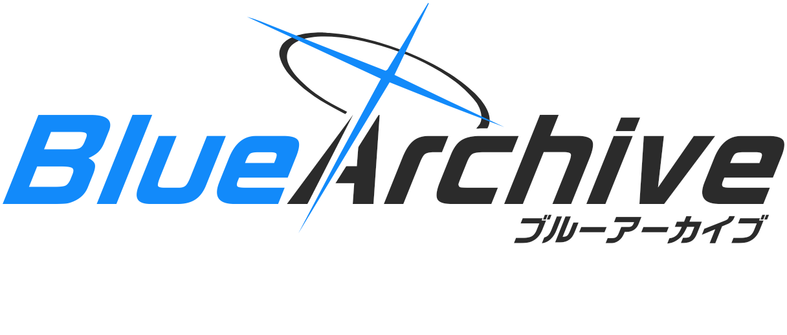
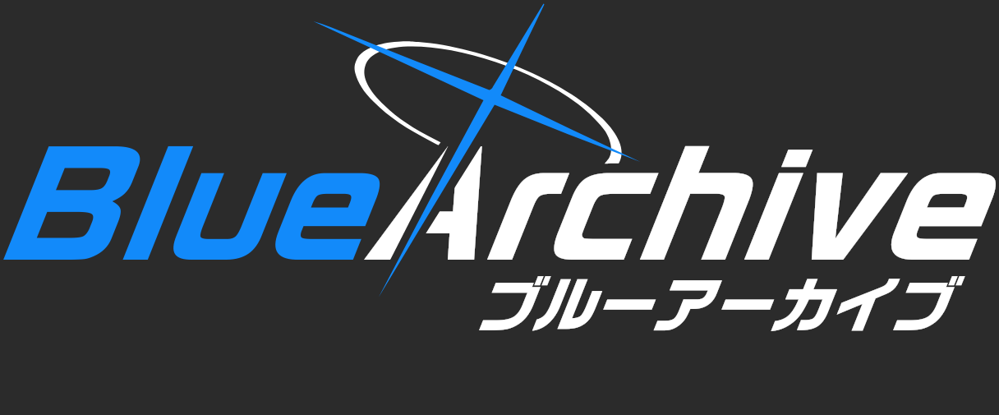
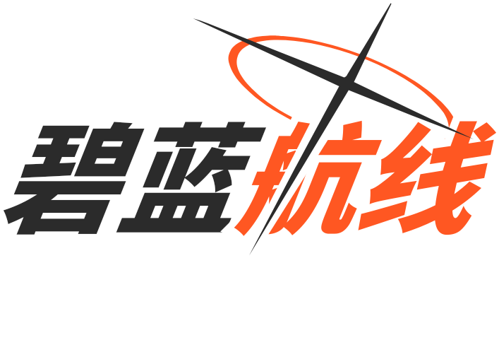
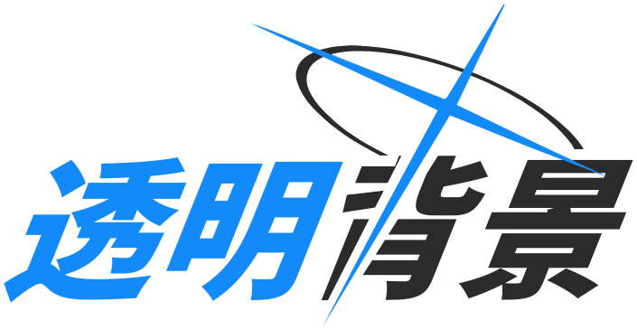
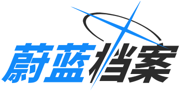
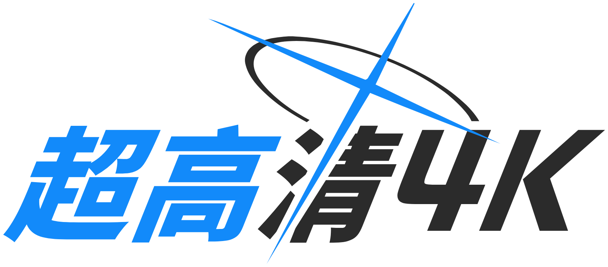

# Blue Archive Logo Generator (蔚藍檔案風格 Logo 產生器)

<div align="center">



[English](README.md) | [简体中文](README.zh-CN.md) | 繁體中文 | [日本語](README.ja.md) | [한국어](README.ko.md)

<br/>

基於 **Bun** + **Elysia** + **Google Skia 原生圖形引擎** 構建的高效能、像素級還原蔚藍檔案風格 Logo 產生服務。

[](https://bun.sh)
[](https://elysiajs.com)
[](https://github.com/Brooooooklyn/canvas)
[](https://vuejs.org)
[](https://github.com/sf-yuzifu/ba-logo-api/actions/workflows/ci.yml)
[](LICENSE)

[線上 WebUI 主控台](#-kivotos-hud-主控台) • [範例展示](#-範例展示) • [核心特性](#-核心特性) • [技術棧](#-技術棧架構) • [快速開始](#-快速開始) • [API 速覽](#-api-呼叫速覽) • [字型參考](#-字型資產參考) • [致謝](#-鳴謝與致敬)

</div>

---

## 📸 範例展示

| 官方英日副標題風格 (2x) | 暗黑模式 (2x) |
| :---: | :---: |
|  |  |
| **自訂強調色與對調 (2x)** | **透明背景鏤空裁切 (明暗自適應, 2x)** |
|  | <picture><source media="(prefers-color-scheme: dark)" srcset="samples/05-transparent-dark-2x.png#gh-dark-mode-only"><source media="(prefers-color-scheme: light)" srcset="samples/05-transparent-2x.png#gh-light-mode-only"></picture> |
| **標準中文 (1x，關閉置中對齊)** | **4K 印刷級超高解析度 (4x)** |
|  |  |
| **入場動效 (GIF 動圖, 24fps)** | **官方英日副標題動效 (APNG 高畫質)** |
|  |  |

---

## ✨ 核心特性

- ⚡ **極致效能躍升**：底層由 C++/Rust 編譯的 Google Skia 原生 2D 圖形內核驅動，單圖生成延遲低至 **8~15ms**，相較傳統無頭瀏覽器方案提速逾 **150 倍**。
- 🎬 **入場動畫生成 (GIF / APNG / SVG / WebP)**：左右文字水平靠攏，左側由上往下著色、右側由下往上著色；十字從中心向外延伸，光環與副標題由左往右展開，支援點陣動圖與純向量 SMIL SVG 匯出。
- 🪶 **極低記憶體佔用**：常駐記憶體僅約 **30~50 MB RSS**，JS 堆疊記憶體維持在 **20 MB** 以內，無沙箱包袱，1C1G 入門型伺服器亦能流暢運行。
- 🎨 **像素級向量精度**：光環（Halo）與十字架（Cross）採用高精度 SVG `Path2D` 向量鏤空演算法，支援 `scale=0.1~8x` 任意縮放，4K 印刷級圖檔依然細膩清晰。
- 🌐 **全量 CJK 字形庫**：內建高品質整合字庫（逾 **30,000 個字形**），完整支援拉丁字母、日文假名、繁體中文、簡體中文與韓文諺文。
- 📦 **多種格式輸出**：原生支援 `png`、`webp`、`jpeg`，免字型依賴的純向量輪廓 `svg`（可直接匯入 Figma / Illustrator），JSON `base64`，以及 `gif`、`apng`、`svg-animated`、`webp-animated` 動圖。
- 🎛️ **Kivotos HUD 主控台**：專為同人創作打造的戰術儀表板前端，具備即時防手震預覽、響應式雙欄/行動裝置置頂吸頂佈局與一鍵分享功能。
- 🔄 **平滑向下相容**：支援標準 RESTful 規範，原有 `/balogo` 端點自動進行 HTTP 308 永久重新導向並完整透傳參數。

---

## 🧰 技術棧架構

| 層級 | 技術選型 | 說明 |
| :--- | :--- | :--- |
| **執行環境** | [Bun](https://bun.sh) (v1.3+) | 超高速 JavaScript/TypeScript 執行時，具備原生秒級冷啟動與高效 HTTP 服務 |
| **Web 框架** | [ElysiaJS](https://elysiajs.com) (v1.4+) | 基於 TypeBox 的端到端型別安全高效能微框架，內建 Swagger / OpenAPI |
| **圖形渲染內核** | [@napi-rs/canvas](https://github.com/Brooooooklyn/canvas) | 基於 Rust 綁定的 Google Skia 2D 原生繪圖引擎 |
| **WebUI 前端** | [Vue 3](https://vuejs.org) + [Vite](https://vitejs.dev) | 蔚藍檔案 Kivotos HUD 戰術風格互動介面，支援多國語言與行動端自適應 |
| **程式碼工程化** | [Biome](https://biomejs.dev) + [TypeScript](https://www.typescriptlang.org) | 嚴格型別檢查、極速格式化、靜態 Lint 與自動化測試套件 |

---

## 🚀 快速開始

### 本地環境執行

請確認已安裝 [Bun](https://bun.sh)（v1.3.14+）：

```bash
# 1. 複製專案代碼庫
git clone https://github.com/sf-yuzifu/ba-logo-api.git
cd ba-logo-api

# 2. 安裝相依套件
bun install --frozen-lockfile

# 3. 啟動本地開發服務
bun dev
```

服務啟動後即可存取：
- **WebUI 互動主控台**：`http://localhost:3000/`
- **Swagger API 偵錯頁**：`http://localhost:3000/swagger`
- **直接獲取圖片**：`http://localhost:3000/api/logo?left=蔚藍&right=檔案`

### 使用 Docker 部署

```bash
# 使用 Docker Compose 一鍵啟動
docker compose up -d

# 或手動建置映像檔並執行
docker build -t ba-logo-api .
docker run -d -p 3000:3000 ba-logo-api
```

---

## 📡 API 呼叫速覽

現代 RESTful 介面路徑：`GET /api/logo` *(舊介面 `GET /balogo` 自動以 HTTP 308 重新導向)*。

### 核心查詢參數

| 參數名 | 別名 | 型別 | 預設值 | 說明 |
| :--- | :--- | :--- | :--- | :--- |
| `left` | `l` | string | `"蔚藍"` | 左側文字（主強調色） |
| `right` | `r` | string | `"檔案"` | 右側文字（次要顏色） |
| `subtitle` | `sub` | string | `""` | 可選副標題（右下方斜體對齊） |
| `subtitleFontSize` | `subSize` | number | `24` | 副標題基礎字級（範圍 `12`–`96`，隨 `scale` 縮放） |
| `accentColor` | `accent` | string | `"#128AFA"` | 主強調色（Hex） |
| `textColor` | `color`, `tc` | string | `"#2B2B2B"` | 主文字顏色（暗黑模式預設為白） |
| `darkMode` | `dark` | boolean | `false` | 是否開啟暗黑模式 |
| `swapColors` | `swap` | boolean | `false` | 是否對調左右文字主題色彩 |
| `transparent`| `tp` | boolean | `false` | 是否啟用透明背景（透明模式將鏤空圖層） |
| `scale` | `s` | number | `1` | 解析度縮放倍率（範圍 `0.1` ~ `8.0`） |
| `format` | - | string | `"png"` | `png`, `webp`, `jpeg`, `svg`, `base64`, `gif`, `apng`, `svg-animated`, `webp-animated` |
| `center` | `vcenter`| boolean | *自適應* | 縱向視覺置中（有副標題預設置中，無副標題預設貼邊） |

*如需查閱完整參數規格與線上除錯，請前往 `/swagger` 頁面。*

### Markdown 嵌入範例

```markdown

```

---

## 🎛️ Kivotos HUD 主控台

造訪服務根路徑 `http://localhost:3000/` 即可使用專屬打造的 Kivotos 戰術主控台：
- **即時調參預覽**：色彩選擇器、像素級微調、動態字距調整；
- **全語言支援**：提供繁體中文、簡體中文、英文、日文及韓文 5 種介面；
- **自適應行動端**：手機與平板享有專屬置頂吸頂視口與浮動工具列；
- **快速分享匯出**：支援直接生成連結、複製 Markdown 語法或下載高解析度圖檔。

---

## 🔤 字型資產參考

本專案內建的高品質整合字型（`assets/fonts/ba.ttf`，約 9.15 MB，總計 **30,000+ 個字形**）經由社群工具精心合併構建，忠實還原遊戲官方排版之視覺張力：

| 語言與字元集 | 主要字型選型 | 來源與參考說明 |
| :--- | :--- | :--- |
| **拉丁字母與日文假名** | [RoG2サンセリフStd B (RoG Sans Serif Std B)](https://www.morisawa.co.jp/fonts/specimen/1646) | 日本 Morisawa 出品的官方原版粗黑無襯線字型，負責所有英數與日文詞條 |
| **繁體中文與簡體中文** | [未來熒黑 (Glow Sans)](https://github.com/welai/glow-sans) (Heavy) | 基於思源黑體改造的開源寬體無襯線字型，筆畫特徵與官方 RoGSans 高度契合 |
| **韓文諺文 (Hangul)** | [Gyeonggi Cheonnyeon Title (경기천년제목)](https://www.gg.go.kr/contents/contents.do?ciIdx=679) (Bold) | 官方韓服採用的同款地域標題粗黑體，視覺骨架厚重有力 |
| **字型合併構建流程** | [Warcraft-Font-Merger](https://github.com/nowar-fonts/Warcraft-Font-Merger) | 執行基準線微調與字形合併，輸出為單一檔案常駐 Skia 記憶體 |

---

## 📜 鳴謝與致敬

本專案遵循 [MIT License](LICENSE) 條款開放原始碼。

特別感謝以下開源先驅與同人社群貢獻者：
- **[@nulla2011](https://github.com/nulla2011)**：打造了標竿級的前端專案 [bluearchive-logo](https://github.com/nulla2011/bluearchive-logo)（[原版線上頁面](https://lab.nulla.top/ba-logo/)），奠定了排版與幾何數學模型基礎；
- **[@jozsefsallai](https://github.com/jozsefsallai)** (PR #6)：貢獻了光環與十字架的高精確度 SVG 向量路徑與暗黑模式構想；
- **[@RedBeanN](https://github.com/RedBeanN)** ([BALogo](https://github.com/RedBeanN/BALogo))：提供了整合完成度極高的 `ba.ttf` 全量字型資產；
- **[@WUGqnwvMQPzl](https://github.com/WUGqnwvMQPzl)** 與 **[@waterv](https://github.com/waterv)**：貢獻了畫布高解析度縮放與動態裁切邊界修正思路。

---

<div align="center">

*免責聲明：Blue Archive (蔚藍檔案) 遊戲商標、圖案及相關智慧財產權均隸屬於 NEXON Games Co., Ltd. 及 Yostar, Inc. 所有。本專案為非官方愛好者同人創作，僅供技術交流研究使用。*

</div>
